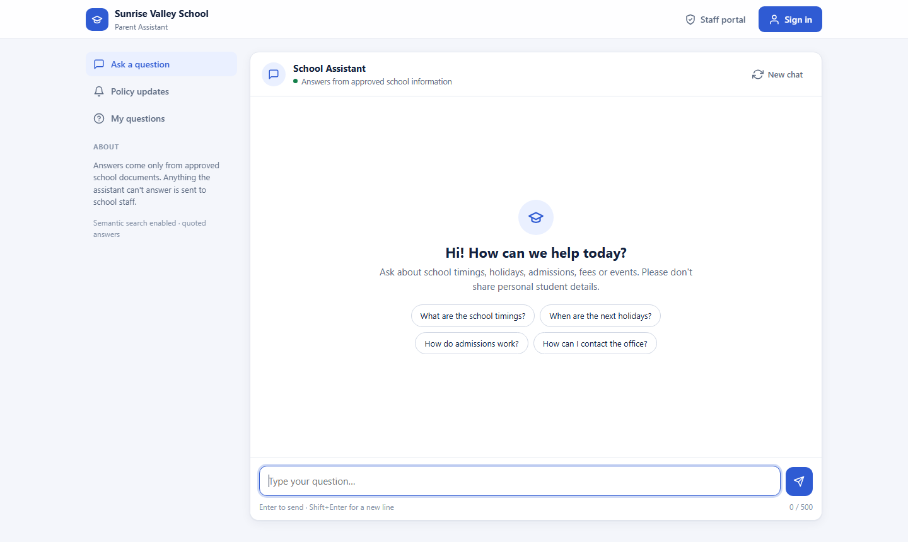
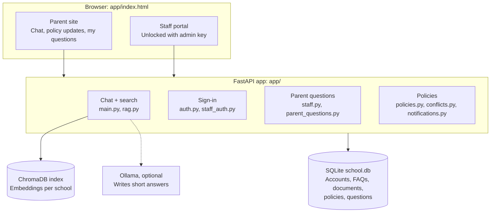
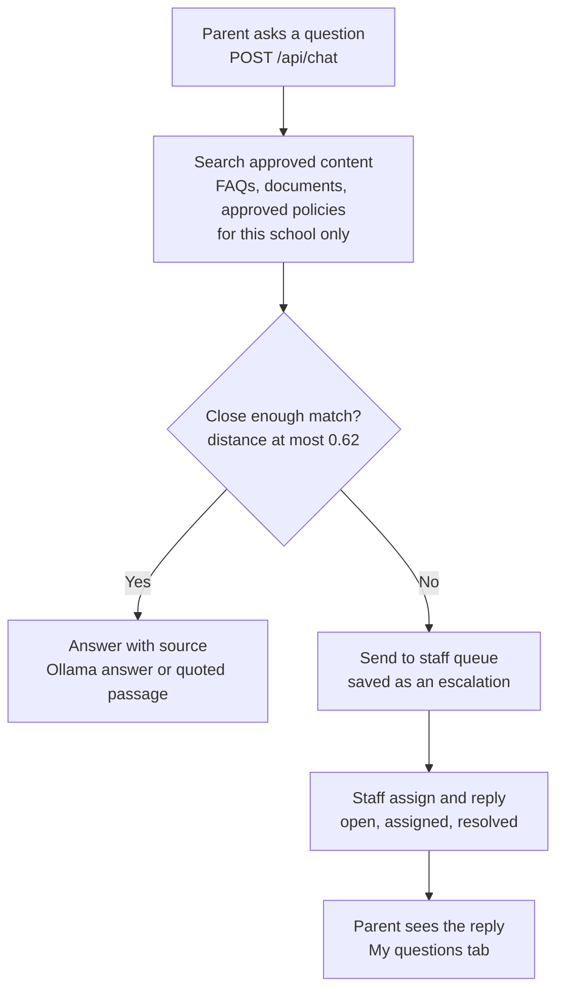
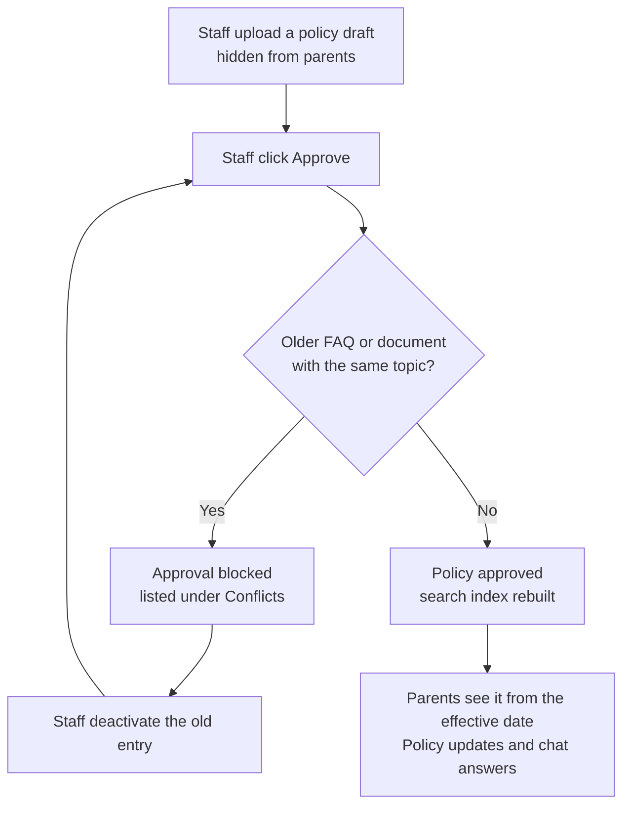

# AI School Parent Communication Assistant — RAG MVP


[](LICENSE)
[](https://www.python.org/)
[](https://fastapi.tiangolo.com/)
[](#how-it-works)
[](#important-limitations)
[](https://school-parent-assistant-demo.onrender.com)
[](https://github.com/rajuerladinny/ai-school-parent-assistant/issues?q=is%3Aissue+is%3Aopen+label%3A%22good+first+issue%22)

A free, self-hosted assistant that answers parents' questions from **approved school documents only**, and hands anything it can't answer to school staff. No paid AI service or API key needed.



> **Status:** Development prototype. Not production-ready. Use fictional school data only. The production security and PostgreSQL acceptance work is in progress; passing local tests alone does not authorize deployment.

**What it does:** Helps parents find answers grounded in approved school FAQs and documents, see policy updates, and escalate unanswered questions to school staff. Administrators manage content and policy review; parent and staff accounts support scoped access in the development implementation.

**Technology:** Python · FastAPI · SQLite (development) · PostgreSQL integration (under validation) · optional ChromaDB / Sentence Transformers · optional Ollama.

**Get involved:** See [CONTRIBUTING.md](CONTRIBUTING.md). Please avoid uploading any real student or parent data. The project uses the Apache License 2.0; see [LICENSE](LICENSE).

**Suggested GitHub topics:** `edtech`, `school-communication`, `parent-engagement`, `fastapi`, `python`, `rag`, `postgresql`, `education`.

Standalone fictional-school demo for parent questions and school staff. Example school: **Sunrise Valley School**. All facts and names are illustrative.

**▶ [Try the live demo](https://school-parent-assistant-demo.onrender.com)** (fictional school, read-only; the free server may take about a minute to wake up). Or run it yourself: `docker build -t school-parent-assistant . && docker run -p 7860:7860 school-parent-assistant` and open http://localhost:7860, or follow the step-by-step [demo guide](docs/demo/DEMO_GUIDE.md).

## How it works

### System overview

One web page (`app/index.html`) has two views: the **parent site** and the **staff portal**. Both call the same FastAPI server, which stores records in SQLite, searches with a local ChromaDB index, and can optionally use a local Ollama model to write answers.



| Part | What it does |
|---|---|
| Parent site | Anyone can ask general questions. Signed-in parents (school code `demo`) also see **Policy updates** and **My questions**. |
| Staff portal | Staff manage the knowledge base, documents, policies and conflicts, reply to parent questions, and create parent accounts. |
| SQLite (`school.db`) | The source of truth for every record. |
| ChromaDB (`chroma_data/`) | A search index built from approved FAQs, documents and policies. It's rebuilt from SQLite whenever content changes. |
| Ollama (optional) | A local model that writes a short answer from the matched passages. Without it, the app shows the matching passage itself. |

### Flow 1: A parent asks a question

The assistant never guesses. It answers only when it finds a close match in approved content for the parent's school. Otherwise, the question goes to a person.



### Flow 2: Staff publish a policy

New policies are hidden until approved. Before approval, the app checks for older FAQ entries or documents on the same topic, so parents never get two conflicting answers.



### Key safeguards

- Answers come only from approved school content, and every answer shows its source.
- Questions without a confident answer go to staff instead of getting a guessed reply.
- Search results are filtered by school, and parents only see their own questions.
- Policies stay hidden until approved and effective, and conflicting older entries block approval.
- Everything runs locally. No hosted AI service or API key is needed.

For a file-by-file map of the code, see [PROJECT_OVERVIEW.md](PROJECT_OVERVIEW.md).

## Roadmap

- [x] Parent chat with source attribution and staff escalation
- [x] Local semantic search (ChromaDB + Sentence Transformers) with optional Ollama answers
- [x] Versioned policies with approval, conflict checks and parent notifications
- [x] Parent and staff accounts with school-scoped sessions
- [x] Redesigned chat-first parent site and separate staff portal
- [x] Free hosted [live demo](https://school-parent-assistant-demo.onrender.com)
- [ ] PostgreSQL as the runtime database (schema, migration and restore tooling already in place)
- [ ] Individual staff sign-in in the portal, replacing the shared admin key
- [x] Docker setup and a read-only public demo mode
- [ ] Multilingual answers for parents
- [ ] Email or SMS notifications for policy updates

Have an idea? Open an [issue](https://github.com/rajuerladinny/ai-school-parent-assistant/issues) or start a [discussion](https://github.com/rajuerladinny/ai-school-parent-assistant/discussions).

## Contributing

Contributions are welcome, from first-timers too.

- Start with an issue labelled [`good first issue`](https://github.com/rajuerladinny/ai-school-parent-assistant/issues?q=is%3Aissue+is%3Aopen+label%3A%22good+first+issue%22) or [`help wanted`](https://github.com/rajuerladinny/ai-school-parent-assistant/issues?q=is%3Aissue+is%3Aopen+label%3A%22help+wanted%22).
- Read [CONTRIBUTING.md](CONTRIBUTING.md) for setup and pull request guidelines.
- Use fictional data only. Never commit real student, parent or school information.

If this project is useful to you, consider giving it a ⭐ and clicking **Watch → Custom → Releases** to hear about new versions.

## Features
- Parent chat with source attribution and staff escalation for unknown questions
- School admin can add/delete approved FAQ entries
- Admin-only upload/list/delete for school documents: PDF, DOCX, TXT, Markdown; 5 MB upload limit
- Document text chunking and local semantic vector retrieval using **ChromaDB + Sentence Transformers**
- Optional local answer generation through **Ollama**; without Ollama, the app returns retrieved excerpts (extractive RAG)
- Keyword FAQ fallback when optional vector dependencies are not installed
- SQLite storage and CI tests

## Run the demo with Docker

```bash
docker build -t school-parent-assistant .
docker run -p 7860:7860 school-parent-assistant
```

Open http://localhost:7860. The image runs in **public demo mode** with semantic search and the fictional Sunrise Valley content already loaded.

### Public demo mode

`SCHOOL_DEMO_MODE=1` turns the app into a safe showcase for a public URL:

- Loads fictional content once: the parent handbook, an approved fee policy (with its resolved conflict), a draft policy, a demo parent account and sample staff questions.
- Shows a demo banner, a **Try the demo** card with one-click parent sign-in, and the staff demo key on the unlock screen.
- Makes the staff portal **read-only**: every change except asking, signing in and out, and marking an update read returns HTTP 403.
- Never stores what visitors type: unanswered questions are explained, not saved.
- Refuses to start with `SCHOOL_ENV=production`. Use a separate database, never one with real records.

The Docker image keeps its database in `/tmp`, so every restart begins with fresh demo data.

### Deploy free on Render

`render.yaml` deploys the public demo on Render's free plan, with lightweight ONNX semantic search that fits its memory. See [docs/RENDER_FREE_DEPLOYMENT.md](docs/RENDER_FREE_DEPLOYMENT.md).

### Deploy to a Hugging Face Space

Docker Spaces currently need a paid Hugging Face plan.

1. Create a Space on huggingface.co with **SDK: Docker**.
2. From this repository, in Git Bash: `scripts/deploy_hf_space.sh <hf-username>/<space-name>`
3. Git asks for your Hugging Face username and an access token with write permission.

The script deploys the last commit with the Space settings from [deploy/huggingface/README.md](deploy/huggingface/README.md).

## Run basic mode

Requires Python 3.10+.

```bash
python -m venv .venv
# Activate the environment for your operating system
pip install -r requirements.txt
# Configure SCHOOL_ADMIN_KEY to a long random secret
uvicorn app.main:app --reload
```

Open http://127.0.0.1:8000. The chat works with sample FAQs. The admin dashboard requires the configured key for changes.

## Enable local RAG vector search

Index rebuilds include active FAQs/documents and the current approved, effective policy versions from every active school. Each record retains its school ID; vector retrieval filters by that school and checks returned metadata again. Rejected, draft, future and disabled-school policies are excluded, and rebuilding removes content that is no longer eligible. Chunk identity includes the school and displayed source metadata, so identical source IDs across schools do not collide and metadata changes invalidate the cache. Offline tests exercise actual temporary Chroma collections and parent chat with deterministic embeddings; they do not establish real-model answer quality. Production vector retrieval remains disabled.

Install the optional dependencies:

```bash
pip install -r requirements-rag.txt
```

The first run downloads the Sentence Transformers embedding model. Vector data persists locally under `./chroma_data` by default. Set `RAG_VECTOR_PATH` to change that directory, and `RAG_EMBEDDING_MODEL` to choose another compatible embedding model.

Upload approved school policy documents in the admin dashboard. Supported file types are PDF, DOCX, TXT and Markdown. PDFs must contain extractable text; scanned PDFs need OCR, which this MVP does not include. Uploaded text and extracted document content are stored in SQLite. Do not upload confidential student records.

## Optional local answer generation

Vector search retrieves the relevant passages. To have a local language model compose a concise answer grounded in those passages, install Ollama separately, pull a model you can run on your computer, and set:

```bash
OLLAMA_BASE_URL=http://localhost:11434
OLLAMA_MODEL=llama3.2:3b
```

If Ollama is not configured or fails, the app transparently returns retrieved excerpts instead of pretending a language model answered. This keeps the MVP usable without OpenAI API keys or hosted model charges. Local models still require disk space, memory and CPU/GPU resources.

## School-aware parent login

The parent login form asks for the school code provided by the school (`demo` for the fictional demo school). Codes match the school's registry slug exactly. The API accepts `school_code` alongside `username` and `password` in `POST /api/auth/login` and authenticates only within that school. Parent usernames are normalized to lowercase, consistent with account creation.

Existing API callers may omit `school_code` only when the username identifies exactly one account across all schools. Duplicate usernames return the same generic HTTP 401 as unknown, disabled, or incorrect credentials; the server never chooses an account by row order or by trying the password against multiple schools. Disabled accounts and schools still count when detecting ambiguity. Existing username/IP throttles also apply across school codes.

This change does not enable production or change SQLite's existing globally unique parent usernames. PostgreSQL permits tenant-scoped parent usernames; its cross-school login behavior is covered by integration tests.

## Verify

```bash
python -m pytest -q
```

`GET /api/health` reports whether vector search dependencies are available. The CI job installs the lightweight base requirements, so it tests upload, permissions, fallback behavior and endpoints without downloading the embedding model.

## Policy management (versioned approvals)

Policy uploads allocate the next version and insert the draft in one transaction. Both the legacy demo and school-admin upload APIs use the same allocator. SQLite takes an immediate write transaction; PostgreSQL locks the school's registry row until commit or rollback, including for the first version. Uploads within a school serialize briefly during allocation; different schools use different row locks. Failed transactions release the lock and do not consume a policy version. This does not enable production operation.

The admin dashboard now includes **Policy versions**. Upload a policy PDF/DOCX/TXT/MD with a stable key (for example `fee-policy`), a title, and a YYYY-MM-DD effective date. Every upload creates a new **draft** version. An administrator must approve or reject it; rejected versions stay in the history but are not searchable. Approved future versions become applicable on their effective date; the system rechecks the date when parents ask questions and rebuilds the vector index when the day changes. The latest *effective, approved* version of each policy key is indexed. Version history is retained in SQLite.

API: `POST /api/policies` (multipart, admin), `GET /api/policies` (admin), `POST /api/policies/{id}/review` (admin JSON `{\"approve\":true}`), `GET /api/policies/active` (public metadata).

**MVP caveats:** The shared admin key is not separate reviewer identity or two-person approval. Legacy FAQs and unversioned documents remain searchable and may conflict with policies until migrated. Changes are reindexed across the whole knowledge collection rather than incrementally. Date-based activation follows the server's local calendar date, so configure the server to the school's timezone. Automatic parent notifications and tamper-evident audit logs are not implemented.

## Important limitations

**Prototype only; do not deploy publicly or use with real student data.** This MVP does not have a production staff identity system, parent verification, tenant isolation, rate limiting, robust audit controls, OCR, or school-grade data governance. The admin key is a shared secret, not individual staff authentication. RAG can retrieve irrelevant passages; the similarity threshold and escalation path reduce but do not eliminate errors. Staff must verify answers about fees, dates, health, safety and school policies.

## Next steps
1. Run the CI workflow and review the pull request.
2. Try approved fictional documents and tune retrieval quality.
3. Add secure staff accounts, document versioning and source-level access control.
4. Validate privacy/security and school needs before any real pilot.


## Feature 5: Potential policy conflicts and knowledge management

When approving a policy, the server scans active FAQ topics and unversioned document titles for exact normalized matches against the policy title or key. Any matches are **potential overlaps**, not proof of contradictory content. Approval is blocked until the administrator deactivates each flagged legacy source. Deactivated knowledge is excluded from vector indexing and keyword fallback, but preserved in SQLite. The admin dashboard includes a conflict list and deactivation controls; the API exposes `GET /api/conflicts`, `POST /api/conflicts/scan/{policy_id}`, and `POST /api/conflicts/legacy/{faq|document}/{id}/deactivate` (admin key required). Reactivation is blocked when a current approved policy has the same topic.

**Limitations:** This first release uses exact topic/key matching, not comprehensive semantic contradiction detection. Different labels for the same subject can escape detection; an administrator must review content manually. No separate two-person reviewer roles or notification service are included. Existing overlapping legacy items are not automatically disabled during migration.


## Feature 6: Parent policy notifications (in-app MVP)

Parents can opt in using a nickname via `POST /api/notifications/subscribe`, receiving an opaque bearer token. The parent inbox `GET /api/notifications` requires `X-Notification-Token` and lists only approved policy versions whose effective date has arrived, with read/unread state. `POST /api/notifications/{policy_id}/read` records a read receipt; `DELETE /api/notifications/subscription` unsubscribes and deletes the subscription/read receipts. Admins can see aggregate counts via `GET /api/notifications/admin/summary` using `X-Admin-Key`.

**Scope and limitations:** This is a free in-app inbox, not automatic push, SMS, email or WhatsApp delivery. Parents must open the app and select Check updates. The demo UI keeps the token only in the current tab, so a refresh requires a new subscription; use a secure parent identity/login system before production. It does not collect contact details or link subscribers to real children. Notifications display policy metadata, not unapproved policy text. Future-dated approvals become visible once effective, without a background scheduler.


## Feature 7: Parent authentication and role isolation (MVP)

Admins create parent accounts using `POST /api/auth/parents` with `X-Admin-Key`, username, display name, and a 12+ character password. Passwords are salted and hashed with Python's built-in scrypt; passwords are not stored in plaintext. Parents log in using `POST /api/auth/login` and use the resulting 12-hour bearer session for `GET /api/auth/me`, `GET /api/notifications/mine`, and `POST /api/notifications/mine/{policy_id}/read`. Each parent's read receipts are isolated by account. Logout revokes the session; admins can disable an account, revoking its sessions. The browser demo keeps the session token only in memory, so reload requires another login.

**Important security limitations:** This is not production-ready authentication. Use HTTPS, rate limiting, account recovery, auditing, secure cookies/CSRF protections or a managed identity provider before handling real families' data. The previous anonymous opt-in demo notification endpoints remain available for backward compatibility and must be disabled before production. The shared admin key remains unchanged. Parents see school-wide policy metadata only; student-specific records and guardian-to-student authorization are not implemented.


## Feature 8: Staff question management

When parent chat cannot confidently answer a question, it enters the existing `escalations` queue. Admins can now list and filter questions using `GET /api/staff/questions?status=open|assigned|resolved`, assign questions to a named staff member, and record a verified resolution via `PATCH /api/staff/questions/{id}` with JSON `{\"status\":\"assigned\",\"assigned_to\":\"Office team\"}` or `{\"status\":\"resolved\",\"resolution\":\"Verified answer\"}`. An event history is available via `GET /api/staff/questions/{id}/history`. All routes require `X-Admin-Key`; the admin dashboard provides assignment, resolution and history controls.

**Limitations:** Staff assignees are text labels, not authenticated staff identities. Resolutions are visible only to administrators; there is no parent-to-question association or parent delivery yet. The workflow records administrative changes but does not automatically promote answers to the approved RAG knowledge base. Use verified school information only; do not enter student-sensitive data.


## Feature 9: Parent question tracking and staff responses

When a logged-in parent asks an unanswered question through `POST /api/chat` with their `Authorization: Bearer <token>` header, the escalation is linked to their parent account and the response includes an `escalation_id`. Parents can review only their own tickets using `GET /api/parent/questions` with the same authorization header. Open and assigned tickets show their status; resolved tickets also show the verified staff response entered through the Feature 8 admin workflow. The parent UI includes **My staff questions**. Anonymous chat still works, but anonymous tickets cannot be claimed later and are only visible to administrators.

**Privacy:** Parent ownership is derived from the authenticated session, never a client-supplied parent ID. Other parents cannot read someone else's tickets. This is in-app pull-based tracking, not push/email/SMS delivery. Avoid sensitive student information until a production-grade identity and privacy design is in place.


## Security hardening (parent authentication)

Parent login now applies a per-client-IP and username throttle of five attempts per five-minute window (HTTP 429 with Retry-After). The throttle is **in-memory per process**, so it is suitable only for the demo; production needs a shared store and proxy-aware IP handling. Legacy anonymous notification subscription, inbox, read and unsubscribe endpoints have been retired; use parent login and `/api/notifications/mine` instead. Legacy SQLite subscription records are not automatically deleted; a reviewed data-retention migration is still required. The administrator uses a shared secret and staff do not yet have individual accounts. Do not use real student/parent information or expose the demo to real school users until production identity, abuse protection, access control, privacy and audit logging are implemented.


## Production security baseline (work in progress)

Set `SCHOOL_ENV=production`, `SCHOOL_ADMIN_KEY` to a random value of at least 32 characters, and `SCHOOL_ALLOWED_HOSTS` to a comma-separated list of exact permitted hostnames. The service refuses to start if these are missing. Set `SCHOOL_ENFORCE_HTTPS=1` only when the reverse-proxy setup forwards scheme correctly; otherwise enforce HTTPS at the ingress. Production mode disables interactive API documentation and requires parent login for chat. Admin knowledge listing is now protected. Basic security headers and SQLite foreign-key enforcement are enabled. CI adds dependency auditing and Git-history secret scanning.

**Not production-ready yet:** This is only a security baseline. SQLite is not a suitable shared production database, the admin key is still shared, staff assignments are labels rather than role-scoped accounts, rate limiting is in-process, CSP allows inline scripts/styles for the current single-file UI, school tenancy is not enforced, and no external penetration test, backup/restore drill, incident plan, or privacy compliance review has been completed. Keep the repo private and do not deploy real school data.


## Multi-school foundation (not yet tenant-isolated)

The schema now includes a `schools` registry and associates parent accounts with a school, defaulting to fictional demo school ID 1 for backward compatibility. **Do not register real schools or real student/parent records yet.** Policies, knowledge, documents, escalation queries and RAG indexes are still globally scoped. Until all resources are tenant-scoped and tested against cross-school access, this is not multi-tenant secure. Production startup refuses SQLite by default; PostgreSQL support and migration remain to be implemented. This intentionally prevents accidental production use of the current demo persistence.


## Tenant isolation: fail-closed phase 1

School ID 1 is the **only** school allowed to access the existing shared parent chat/RAG, notification inbox, and question history. Parent sessions linked to any other school receive HTTP 403 on these endpoints. This is intentional: the existing FAQ, policy, document and vector indexes are not tenant-partitioned. It prevents cross-school exposure via authenticated parent endpoints while tenant-specific persistence, staff/admin scoping, retrieval and migrations are built. **This is not completed multi-school isolation** and not permission to onboard real schools. The public demo chat remains available when `SCHOOL_ENV` is not production; production mode requires a parent session. School ID 1 must remain fictional demonstration data.


## Tenant content schema phase 2 (incomplete)

FAQ, uploaded documents and policy versions now carry `school_id`, existing records are assigned to fictional demo school ID 1, and Chroma embeddings carry a school filter. Legacy admin endpoints are restricted to school 1. Parent accounts in other schools are still denied access to shared parent content by the earlier fail-closed guard. **This is a schema and filtering milestone only:** it does not enable multi-school onboarding, per-school admin RBAC, fully partitioned indexes, tenant-specific staff workflow, PostgreSQL, or production operation. The existing global uniqueness of `policy_versions(policy_key,version)` must be replaced with a tenant-scoped uniqueness constraint in a tested migration before multiple schools can author policies.


## PostgreSQL migration — phase 1: schema validation

`migrations/postgresql/001_initial.sql` defines a tenant-aware PostgreSQL 16 schema. `.github/workflows/postgres-schema.yml` runs the schema against a temporary PostgreSQL database and checks per-school policy version uniqueness. This **does not migrate existing SQLite data** or switch the API's runtime connection to PostgreSQL. The application remains SQLite-only and refuses production startup with SQLite. Do not run this schema against an existing production database without reviewing migration/version tracking, data retention, credentials, backup and rollback procedures. Next phases must implement the PostgreSQL repository adapter, audited SQLite-to-Postgres data transformation, verification and restore drills.


## Experimental SQLite to PostgreSQL transfer utility

`scripts/migrate_sqlite_to_postgres.py` copies the 12 application tables listed in `TABLES`, including staff workflows, sessions, receipts and conflict history, from a **quiesced**, backed-up SQLite database into an **empty** initialized PostgreSQL schema. It defaults to a rollback-only dry run; `--apply` commits only after row counts, every copied column and relationship checks pass. The source is opened read-only with a consistent snapshot, including filenames containing URI-special characters. Boolean flags must be 0 or 1; timezone-aware timestamps preserve their instant, and naive SQLite timestamps are interpreted as UTC. Identity sequence resets are transactional, so dry runs and failures leave no sequence changes.

The migration takes exclusive locks on the target application tables and requires ownership of their identity sequences. Populated unsupported tables (including retired anonymous notification records) and unexpected source columns require an explicit archive or migration decision; they are never silently discarded. Failed transfers roll back and can be retried against the empty target. This does not switch the API runtime or authorize real-school migration. ChromaDB remains a separate index and must be rebuilt from approved, tenant-scoped records.


## Staff identity milestone (not production authentication)

Individual school-linked `school_admin` and `staff` accounts can be provisioned through `POST /api/staff-auth/accounts` using the legacy bootstrap administrator key. Staff sign in at `/api/staff-auth/login` and use bearer credentials on `/api/staff/mine/questions`. Queries and updates are filtered by the authenticated school. This is **not complete production RBAC**: the legacy shared-admin-key routes remain available for demo school 1, login throttling, account lifecycle, password recovery, bootstrap rotation and audited permission enforcement are still required. No real school onboarding is supported.


## Backup and restore verification foundation

Both `scripts/verify_postgres_restore.py` and `scripts/postgres_restore_verify.py` run the same `pg_dump`/`pg_restore` drill into a **separate empty disposable PostgreSQL database**, validate required schema/security triggers, and compare every application column, row count and identity sequence state. The restore runs in one transaction. Both tools reject connections that resolve to the same database or a populated target schema. Keep the source quiesced during the dump and comparison. Requires PostgreSQL client tools and `psycopg`. Fictional-data integration tests populate all 12 migrated tables and detect content or sequence changes even when counts match. Production recovery still needs encrypted offsite storage, point-in-time recovery, retention, restore-time objectives, RAG reindexing and operational approval.


## PostgreSQL runtime adapter — incremental milestone

`app/postgres_adapter.py` provides a psycopg-backed connection wrapper that converts parameter placeholders and returns dictionary rows. It deliberately rejects SQLite-only PRAGMA and INSERT OR IGNORE statements and requires explicit RETURNING id for PostgreSQL inserts. **The main application is not yet wired to this adapter**: its startup schema, implicit row IDs, SQLite DDL and transactional behavior must be migrated and end-to-end tested first. Do not configure a PostgreSQL DSN in `SCHOOL_DB` expecting it to work. The production SQLite startup restriction remains in place.


## Explicit PostgreSQL schema bootstrap

`python scripts/postgres_bootstrap.py --dsn <POSTGRES_DSN> --initialize-empty` initializes only an empty PostgreSQL schema. Omitting `--initialize-empty` validates the required tables. CI exercises validation and rejects reinitializing a populated schema. This does **not** activate PostgreSQL as the FastAPI runtime; runtime SQL conversion, schema alignment and end-to-end tests are still required. Never embed real database credentials in shell history or logs.


## Database backend selection (safety gate)

`SCHOOL_DATABASE_BACKEND=sqlite` is the only runnable demo backend at present. The new `SCHOOL_DATABASE_BACKEND=postgres` configuration is **intentionally rejected**, even with `SCHOOL_POSTGRES_RUNTIME_READY=1`, until full PostgreSQL query conversion and integration tests are complete. Production startup refuses SQLite. This prevents accidental live deployment with a partially converted database layer.


## PostgreSQL SQL compatibility inventory

Run `python scripts/audit_sqlite_sql.py` to list SQLite-only PRAGMA statements, INSERT OR IGNORE, implicit lastrowid, table_info, INTEGER PRIMARY KEY and COLLATE NOCASE occurrences in the application. Run with `--strict` to fail if any remain. This is a static migration checklist and does **not** make the runtime PostgreSQL-compatible. Actual conversion requires replacing these operations, aligning PostgreSQL schema with application models, and integration testing every route.


## Free online demo deployment (Render)

The repository includes a `render.yaml` Blueprint for a **free, fictional-data-only** FastAPI deployment. See [Render Free deployment instructions](docs/RENDER_FREE_DEPLOYMENT.md) for setup, verification and limitations. It runs in public demo mode with lightweight ONNX semantic search (no PyTorch), which fits the free instance. SQLite lives on an **ephemeral** filesystem, so accounts and changes can disappear. Do **not** use real parent or student data. Deployment must be authorized and initiated in your own Render account; adding the Blueprint does not deploy automatically.
